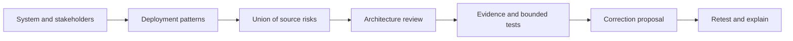

# AI Security Wiki — DASF reference and MCP for agent security

**Understand an AI system. Identify its risks. Investigate evidence. Propose a fix. Verify the result.**

An independent, community reference built by **Matheus Borges** around the [Databricks AI Security Framework (DASF)](https://www.databricks.com/resources/whitepaper/databricks-ai-security-framework-dasf). It combines a linked Markdown wiki, a versioned knowledge graph, an MCP server and a portable audit skill.

I started this project to study AI security in depth and make defensive knowledge easier to use at scale. The goal is to help people and agents ask better questions, trace answers to evidence and share useful improvements with the community.

[Explore the website](https://mathborgess.github.io/ai-security-wiki/) · [Read the wiki](wiki/index.md) · [Português](README.pt-BR.md) · [Audit workflow](wiki/methodology.md) · [MCP setup](docs/mcp.md) · [Contribute](CONTRIBUTING.md)

[](https://m8ven.ai/mcp/mathborgess/ai-security-wiki?s=readme)

The [M8ven score](https://m8ven.ai/mcp/mathborgess/ai-security-wiki?s=readme) is an external automated assessment, not a security guarantee or certification.

## Start with your security question

- [AI agent security checklist](guides/agent-security-checklist.md): classify the architecture and inspect trust boundaries.
- [MCP security checklist](guides/mcp-security.md): review clients, servers, credentials and tool authorization.
- [Prompt injection in RAG and agents](guides/prompt-injection.md): trace untrusted content to a concrete effect.
- [PentAGI, Cloudflare and Red Blue Field](wiki/research/index.md): study investigation architecture, coverage and independent verification.
- [Evidence-driven audit playbook](guides/evidence-driven-audit.md): move from a synthetic hypothesis to proposed correction and retest.
- [Use with Claude, Codex, ChatGPT or another agent](docs/clients.md): choose web reference access or local MCP integration.

The [static documentation site](docs/discoverability.md) is generated from this wiki, with a searchable reference, Markdown alternates and a sitemap. To cite or adapt the work, use [CITATION.cff](CITATION.cff) and preserve the original [DASF attribution](NOTICE).

## What is included

The **2026-10-22 snapshot of DASF 3.0** indexes **97 risks, 73 controls, 804 risk–control links, 13 components, seven deployment patterns and 46 tool-directory entries**. Each risk and control links to its source spreadsheet row, implementation references and source-reported framework mappings. See [provenance and limits](wiki/sources.md).

- **LLM Wiki:** small linked pages, an explicit entry point, source records, generated indexes and a change log. Agents retrieve only the pages they need.
- **MCP:** ten read-only tools, reference resources and two prompts for classification, scoping, investigation, remediation proposals and explanations.
- **Skill:** [audit-ai-security](skills/audit-ai-security/SKILL.md), with an evidence-oriented working profile, cited methods and two review lenses.
- **Verification:** deterministic source checks and a real MCP client test. [Validation report](docs/validation.md) distinguishes software tests from domain and host behavior.

The complementary research library adds six original guides/templates, with pinned revisions and a [separate source manifest](sources/research.json). Search them through `search_knowledge` with `kind: "reference"`, then use `get_reference` with a returned name. The same guides appear in website search, HTML and Markdown. These are reference adaptations, not new official DASF entries or executed upstream integrations.

## Try it

Requires Node.js 22 or later and npm. No model key, database, Databricks account or paid service is needed to run the reference server.

```sh
git clone https://github.com/MathBorgess/ai-security-wiki.git
cd ai-security-wiki
npm ci --ignore-scripts
npm run check
npm run demo
```

Use the absolute path to `src/server.mjs` in an MCP client configuration:

```json
{
  "mcpServers": {
    "ai-security-wiki": {
      "command": "node",
      "args": ["/absolute/path/to/ai-security-wiki/src/server.mjs"]
    }
  }
}
```

The server uses **stdio** and runs locally. A client must support MCP tools over stdio; resource and prompt support adds richer navigation. This repository does not operate a hosted endpoint. [Client-specific notes and the protocol contract](docs/mcp.md) explain the integration boundary.

Ask your agent:

> Audit the design of my retrieval assistant. It uses an external foundation model and an MCP tool that can create support tickets. Start by identifying all deployment patterns, then show applicable risks, missing evidence and proposed checks. Do not execute tests yet.

The first useful result is a scoped audit plan. A catalog match alone is **not** a finding. The server teaches the audit method; the calling agent uses its separately authorized tools to inspect the actual system.



## Honest boundaries

The source contains [inconsistencies](wiki/source-issues.md). Blank applicability remains unspecified; reverse graph disagreements remain visible; source filtering does not replace architectural judgment. The project adds verification guidance without presenting it as Databricks-authored material.

This is an educational and assessment aid, not a scanner, certification, compliance attestation or guarantee of safety. It does not execute attacks, apply fixes or install tools in the target system. No Databricks affiliation or endorsement is implied. Code is Apache-2.0; DASF-derived knowledge and documentation are CC BY-SA 4.0. See [LICENSE](LICENSE) and [NOTICE](NOTICE).

## Study public security methods

Explore [Jason Haddix's repositories, tools and report-reading path](wiki/research/jason-haddix.md), then use [map-attack-surface](skills/map-attack-surface/SKILL.md) to prepare a scoped evidence map. The skill complements DASF; it does not run reconnaissance. [Validation limits](docs/jhaddix-study-validation.md).

Use [ask-cyber-specialist](skills/ask-cyber-specialist/SKILL.md) to explain mechanisms, challenge hypotheses and plan studies with a pocket cybersecurity mentor. Explore [Jason Haddix’s posts and media](wiki/research/jason-haddix-media.md), [spikee evaluation design](wiki/research/spikee-evaluation.md) and the [observed skill evaluation](docs/cyber-specialist-validation.md).
