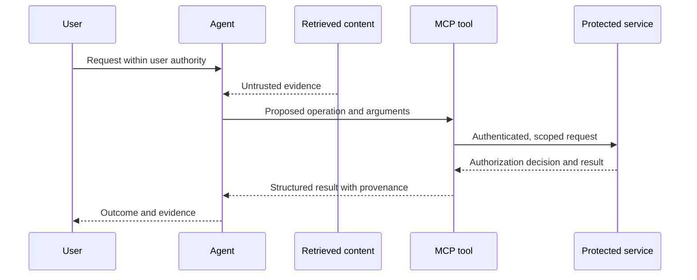

# Agent and MCP trust boundaries

The DASF v3 catalog adds risks for the [agent core](components/13.md), MCP servers and MCP clients. These overlap with the supporting data, model and platform lifecycle. An agent’s ability to act makes the effective authority of each tool and its downstream service central to the investigation.

## Follow one action through the system

Project-authored investigation prompts:

| Boundary | What to establish | Relevant starting points |
|---|---|---|
| Retrieval → reasoning | Content does not gain instruction authority; retrieval respects the user’s data permissions | [9.1](risks/9.1.md), [13.16](risks/13.16.md), [DASF-46](controls/46.md), [DASF-54](controls/54.md) |
| Model → tool | The requested action, arguments and destination remain within user authority | [13.2](risks/13.2.md), [13.22](risks/13.22.md), [DASF-64](controls/64.md) |
| Tool → downstream service | The service validates identity, audience and effective privileges | [13.17](risks/13.17.md), [13.19](risks/13.19.md), [DASF-67](controls/67.md) |
| Session → memory | State is isolated by tenant/user and contaminated state can be invalidated | [13.1](risks/13.1.md), [13.34](risks/13.34.md), [DASF-72](controls/72.md) |
| Human → side effect | Approval is bound to the exact action, expires and cannot be replayed | [13.10](risks/13.10.md), [DASF-66](controls/66.md) |
| Client → server metadata | The client verifies server identity and reviews changes to tools or destinations | [13.26](risks/13.26.md), [13.29](risks/13.29.md), [DASF-70](controls/70.md) |
| Agent → agent | Delegated authority does not widen and messages preserve origin | [13.12](risks/13.12.md), [13.13](risks/13.13.md), [DASF-71](controls/71.md) |
| Execution → network/resources | Egress, isolation and budgets constrain harmful effects independently of the model | [13.4](risks/13.4.md), [DASF-34](controls/34.md), [DASF-56](controls/56.md), [DASF-60](controls/60.md) |

The [MCP security best practices](https://modelcontextprotocol.io/docs/2026-07-28/tutorials/security/security_best_practices) describe protocol threats including confused deputies, token passthrough, SSRF and state-handle abuse. Use an audience-bound token for each service; do not treat a session identifier as authentication. If a remote deployment is added, assess its transport, authorization and network boundaries separately.

For traceability, collect decision summaries, identities, tool arguments, authorization outcomes and effects, with redaction. Hidden model chain-of-thought is neither required nor a trustworthy substitute for observable action evidence. This is an explicit adaptation of DASF-65 for portable auditability.
